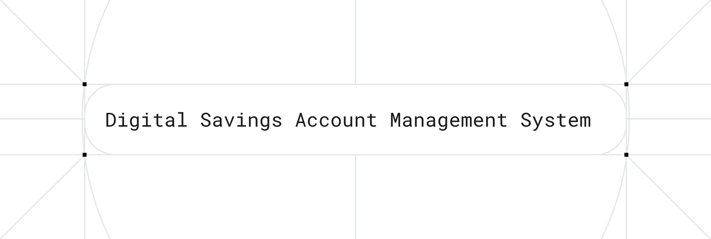

# Digital Savings Account Management System

A full-stack banking application that allows customers to apply for and manage digital savings accounts, and enables admins to review, approve, and monitor accounts securely.




Built using:
- **Backend:** Spring Boot, PostgreSQL, JWT Security
- **Frontend:** Vue.js, TypeScript, TailwindCSS


## 📁 Project Structure
```
digital-savings-account-management-system/
├── backend/ # Spring Boot application (DigiSavingsCore)
├── frontend/ # Vue.js application
├── k8s/ # Kubernetes YAML files
└── README.md
```


## 🚀 Getting Started

### Prerequisites

- **Java:** JDK 17 (recommended)
- **Node.js:** v20 or higher
- **PostgreSQL:** v13 or higher
- **Maven:** 3.8+
- **npm:** Latest version


## 🚀 How to Run the Application (Local)

### 1. Clone the repository
```bash
git clone -b prod https://github.com/ChandanKhamitkar/zeta-digital-savings-account-management-system.git
cd zeta-digital-savings-account-management-system
```

### 2. Run backend
```bash
cd backend/digisavings-core

# Configure database in application.properties
# spring.datasource.url=jdbc:postgresql://localhost:5432/digisavings
# spring.datasource.username=your_username
# spring.datasource.password=your_password

# Run the application
mvn clean install
mvn spring-boot:run
```
Backend runs at: http://localhost:8080


### 3. Run frontend
```bash
cd frontend/digital-savings-account-management-system

# Install dependencies
npm install

# Create environment file
echo "VUE_APP_API_BASE_URL=http://localhost:8080/api" > .env

npm run serve 
```
Frontend runs at: http://localhost:5173

### 4. Default Credentials

**Admin Login:**
```
Email: superadmin@bank.com
Password: superpassword
```

## Module Documentation
Backend details → [/backend/README.md](./backend/digisavings-core/README.md)

Frontend details → [/frontend/README.md](./frontend/digital-savings-account-management-system/README.md)

## 🧪 Testing

### Backend Tests
```bash
cd backend/digisavings-core
mvn test
```

### Frontend Tests
```bash
cd frontend/digital-savings-account-management-system
npm run test:unit
```

## Team & Contribution

This project is developed as a capstone project using a collaborative full-stack workflow with Git, Spring Boot and Vue.js.

### Development Team

| Name | GitHub |
|------|--------|
| Khamitkar Sai Chandan | [@ChandanKhamitkar](https://github.com/ChandanKhamitkar) |
| Bharadi Harshitha | [@Harshi-7](https://github.com/Harshi-7) |
| Karanam Hima Varsha | [@HimaVarshaKaranam](https://github.com/HimaVarshaKaranam) |
| Venkata Sri Sumedha Guddati | [@SumedhaGuddati](https://github.com/SumedhaGuddati) |


## 📝 License

This project is developed as part of a capstone project.

## 🙏 Acknowledgments

Special thanks to our trainer for their guidance throughout this project.

## 📧 Contact

For questions or feedback, please reach out to any of the project contributors via their GitHub profiles.

**⚡ Built by Team ZetaRise**
