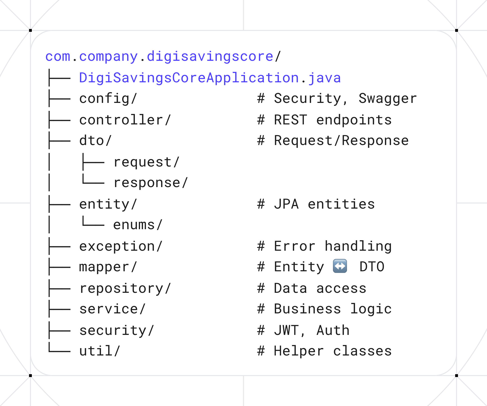

# DigiSavingsCore - Backend

A secure and scalable Spring Boot backend system for managing digital savings accounts, providing RESTful APIs for customer account management, transactions, and administrative operations.


## 🛠️ Tech Stack

- **Framework:** Spring Boot 3.x
- **Language:** Java 17
- **Database:** PostgreSQL
- **Security:** Spring Security + JWT
- **ORM:** Spring Data JPA + Hibernate
- **Build Tool:** Maven
- **Documentation:** Swagger/OpenAPI
- **Testing:** JUnit 5 + Mockito


## 📂 Project Structure




## 🚀 Getting Started

### Prerequisites

- **Java:** JDK 17 or higher
- **Maven:** 3.8+
- **PostgreSQL:** 13 or higher
- **IDE:** IntelliJ IDEA

### Installation
```bash
# Clone the repository
git clone -b prod https://github.com/ChandanKhamitkar/zeta-digital-savings-account-management-system.git

# Navigate to backend directory
cd zeta-digital-savings-account-management-system/backend/digisavings-core
```

### Database Setup

1. Create PostgreSQL database:
```sql
CREATE DATABASE digisavings;
```

2. Configure database in `application.properties`:
```properties
spring.datasource.url=jdbc:postgresql://localhost:5432/digisavings
spring.datasource.username=your_username
spring.datasource.password=your_password
```

### Run the Application
```bash
# Install dependencies and build
mvn clean install

# Run the application
mvn spring-boot:run
```

**Backend runs at:** `http://localhost:8080`


## 🔌 API Endpoints

### Authentication
- `POST /api/auth/signup` - Register new user
- `POST /api/auth/login` - User login
- `POST /api/auth/send-otp` - Send verification OTP
- `POST /api/auth/verify-otp` - Verify OTP
- `POST /api/auth/forgot-password/send-otp` - Send OTP for Reset password
- `POST /api/auth/forgot-password/verify-otp` - Verify OTP for Reset password
- `POST /api/auth/forgot-password/reset` - Reset password

### User Account Management
- `GET /api/accounts/me` - Get account details
- `GET /api/accounts/me/profile` - Get user profile
- `POST /api/accounts/me/deposit` - Deposit money
- `POST /api/accounts/me/withdraw` - Withdraw money
- `GET /api/accounts/me/transactions` - Get transaction history

### Account Application
- `POST /api/accounts/apply` - Submit account application
- `GET /api/accounts/application/status` - Get application status

### Admin Operations
- `GET /api/admin/applications/approved` - View all approved applications
- `GET /api/admin/applications/pending` - View all pending applications
- `PUT /api/admin/applications/{id}/approve` - Approve application
- `PUT /api/admin/applications/{id}/reject` - Reject application
- `GET /api/admin/dashboard/stats` - Dashboard statistics
- `GET /api/admin/audit/logs` - Get audit logs
- `GET /api/admin/audit/event-types` - Get event types


## 🧪 Testing

### Run All Tests
```bash
mvn test
```

### Run Specific Test Class
```bash
mvn test -Dtest=AccountServiceTest
```

### Generate Test Coverage Report
```bash
mvn jacoco:report
```

Report available at: `target/site/jacoco/index.html`


## 📦 Build & Package

### Create JAR
```bash
mvn clean package
```

### Run JAR
```bash
java -jar target/digisavings-core-1.0.0.jar
```

### Skip Tests During Build
```bash
mvn clean package -DskipTests
```

## 🔧 Development Tools

### Useful Maven Commands
```bash
# Clean build
mvn clean

# Compile
mvn compile

# Run tests
mvn test

# Package
mvn package

# Install to local repository
mvn install

# Run application
mvn spring-boot:run

# Generate project reports
mvn site
```

## 👥 Development Team

| Name | GitHub |
|------|--------|
| Khamitkar Sai Chandan | [@ChandanKhamitkar](https://github.com/ChandanKhamitkar) |
| Bharadi Harshitha | [@Harshi-7](https://github.com/Harshi-7) |
| Karanam Hima Varsha | [@HimaVarshaKaranam](https://github.com/HimaVarshaKaranam) |
| Venkata Sri Sumedha Guddati | [@SumedhaGuddati](https://github.com/SumedhaGuddati) |


## 📝 License

This project is developed as part of a capstone project.


**⚡ Engineered by Team ZetaRise**