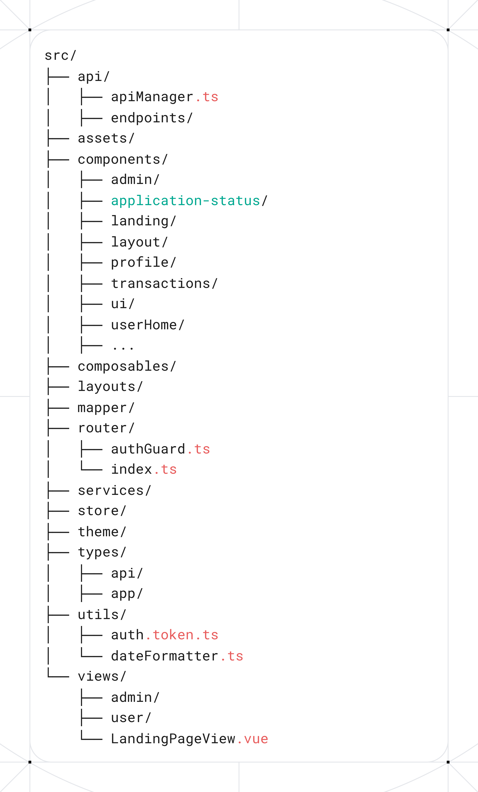

# Digital Savings Account Management System - Frontend

A modern, secured banking application frontend built with Vue.js 3, TypeScript, and TailwindCSS, providing an intuitive interface for customers to manage digital savings accounts and administrators to oversee banking operations.

## 🛠️ Tech Stack

- **Framework:** Vue.js 3 (Composition API)
- **Language:** TypeScript
- **Styling:** TailwindCSS 4.x
- **State Management:** Vuex
- **Routing:** Vue Router with Auth Guards
- **Build Tool:** Vue CLI + Babel
- **Testing:** Jest (Unit Tests)
- **HTTP Client:** Axios
- **Icons:** Font Awesome
- **Notifications:** Vue Hot Toast


## 📦 Key Dependencies

| Package | Purpose | Documentation |
|---------|---------|---------------|
| `@fortawesome/vue-fontawesome` | Icon library | [FontAwesome](https://fontawesome.com/) |
| `@steveyuowo/vue-hot-toast` | Toast notifications | [Vue Hot Toast](https://www.npmjs.com/package/@steveyuowo/vue-hot-toast) |
| `axios` | HTTP requests | [Axios](https://axios-http.com/) |
| `vuex` | State management | [Vuex](https://vuex.vuejs.org/) |
| `vue-router` | Client-side routing | [Vue Router](https://router.vuejs.org/) |

## 🚀 Quick Start

### Prerequisites
- **Node.js:** v20 or higher
- **npm:** Latest

### Installation
```bash
# Clone the repository
git clone -b prod https://github.com/ChandanKhamitkar/zeta-digital-savings-account-management-system.git

# Navigate to frontend directory
cd zeta-digital-savings-account-management-system/frontend/digital-savings-account-management-system

# Install dependencies
npm install
```

### Environment Configuration

Create a `.env` file in the root directory:
```env
VUE_APP_API_BASE_URL=http://localhost:8080/api
```

---

## 💻 Development

### Run Development Server
```bash
npm run serve
```
Application will be available at: `http://localhost:5173`

### Build for Production
```bash
npm run build
```
Production-ready files will be generated in the `dist/` directory.

### Run Unit Tests
```bash
npm run test:unit
```


## 📂 Project Structure



## 🎨 Features

### Customer Portal
- Secure authentication with JWT
- Account application with real-time validation
- Dashboard with account overview
- Transaction management (deposit/withdraw)
- Transaction history with filtering
- User Profile Visibility
- Application status tracking

### Admin Portal
- Application review & approval workflow
- Analytics dashboard
- User account management
- Audit logs

## 🔒 Authentication & Authorization

The application implements:
- JWT-based authentication
- Role-based route guards (USER/ADMIN/SUPER_ADMIN)
- Account status-based access control (PENDING/APPROVED/REJECTED)
- Protected API endpoints

## 🧪 Testing

Unit tests are written using Jest and Vue Test Utils:
```bash
# Run all tests
npm run test:unit

# Run tests with coverage
npm run test:unit -- --coverage
```

Test files are located alongside components with `.spec.ts` extension.

## 🌐 API Integration

The frontend communicates with the Spring Boot backend via RESTful APIs:

**Base URL:** `http://localhost:8080/api`

**Key Endpoints:**
- `/auth/*` - Authentication endpoints
- `/accounts/me/*` - User account operations
- `/admin/*` - Admin operations

API configuration is managed through `apiManager.ts` with automatic:
- Request/response interceptors
- Token attachment
- Proper mapped endpoints

## 🎯 Build & Deployment

### Production Build
```bash
npm run build
```

### Development Team

| Name | GitHub |
|------|--------|
| Khamitkar Sai Chandan | [@ChandanKhamitkar](https://github.com/ChandanKhamitkar) |
| Bharadi Harshitha | [@Harshi-7](https://github.com/Harshi-7) |
| Karanam Hima Varsha | [@HimaVarshaKaranam](https://github.com/HimaVarshaKaranam) |
| Venkata Sri Sumedha Guddati | [@SumedhaGuddati](https://github.com/SumedhaGuddati) |


## 📝 License

This project is developed as part of a capstone project.

**⚡ Engineered by Team ZetaRise**